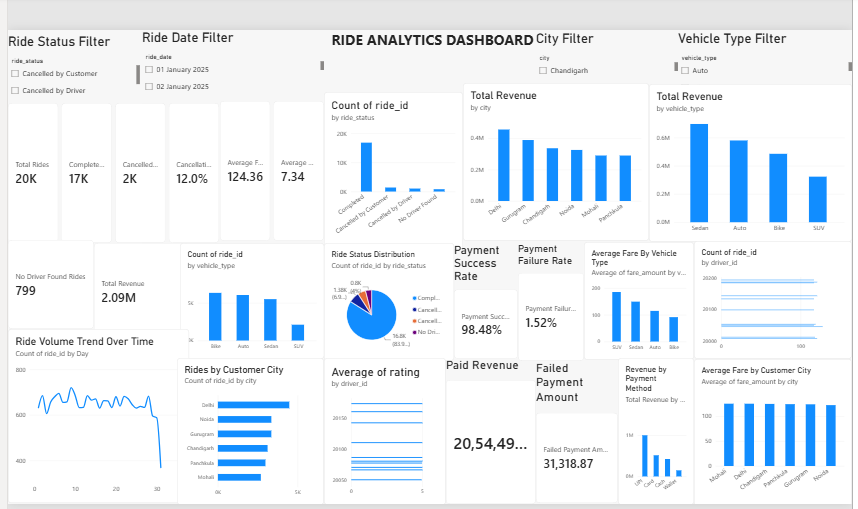

Ride Analytics & Business Performance Dashboard

📌 Project Overview

An end-to-end Data Analytics portfolio project built to analyze ride-booking operations, revenue trends, customer behavior, driver performance, vehicle utilization, cancellations, locations, and payment performance.

The project uses Microsoft Excel, SQL (MySQL), Python (Pandas), and Power BI to transform raw ride-booking data into structured analysis and actionable business insights.

The workflow covers data cleaning, data validation, relational data modeling, SQL-based analysis, Python exploratory data analysis, Excel report generation, and interactive dashboard development.

---

🎯 Business Objectives

The main objectives of this project are to:

- Analyze overall ride-booking performance.
- Track completed, cancelled, and other ride statuses.
- Measure ride completion and cancellation rates.
- Analyze ride fare revenue and average fare.
- Compare performance across vehicle categories.
- Examine monthly ride volume and revenue trends.
- Understand customer activity and city-level patterns.
- Evaluate driver performance and ratings.
- Analyze payment methods, successful payments, and failed payments.
- Identify operational patterns and opportunities for improvement.
- Present key metrics through an interactive Power BI dashboard.

---

🛠️ Tools & Technologies

Tool| Purpose
Microsoft Excel| Data cleaning, validation, and preparation
MySQL| SQL queries, aggregations, joins, and business analysis
Python| Data processing and exploratory data analysis
Pandas| Data loading, cleaning, grouping, merging, and analysis
Power BI| Data modeling, DAX measures, KPIs, and interactive visualization
GitHub| Project documentation, code storage, and portfolio presentation

---

📂 Dataset Overview

The project uses multiple related datasets representing different parts of a ride-booking business.

Dataset| Description
Customers| Customer IDs, names, demographics, cities, and signup dates
Drivers| Driver IDs, demographics, cities, joining dates, and ratings
Vehicles| Vehicle IDs, associated drivers, vehicle types, models, and years
Locations| Location IDs, cities, areas, and zone types
Rides| Ride IDs, customer and driver IDs, vehicle IDs, locations, dates, fares, distances, and ride statuses
Payments| Payment IDs, ride IDs, payment methods, payment statuses, and payment amounts
Data Dictionary| Documentation describing table purposes and data grain

Dataset Scale

- Rides: 20,000 records
- Customers: 1,000 records
- Drivers: 200 records
- Vehicles: 200 records in the vehicle analysis dataset
- Locations: 30 records
- Payments: 16,795 records

The ride dataset contains the main transactional information used to analyze booking activity, ride status, fare amounts, and distance.

---

🧹 Data Cleaning & Preparation

Data cleaning and preparation were performed primarily in Microsoft Excel, followed by data-quality checks in Python.

Major activities included:

- Checking for duplicate records.
- Identifying missing and blank values.
- Reviewing column names and removing unnecessary columns.
- Validating date fields and data types.
- Checking location IDs and relationships between datasets.
- Reviewing customer, driver, vehicle, ride, and payment data.
- Creating cleaned datasets while retaining the original raw data separately.
- Checking dataset dimensions and column names in Python.
- Reviewing missing values and duplicate counts using Pandas.

The cleaned datasets were then used for SQL analysis, Power BI modeling, and Python-based analysis.

---

🔗 Data Modeling

The Power BI data model connects the major business entities to the ride transactions.

Key relationships include:

- Customers → Rides
- Drivers → Rides
- Vehicles → Rides
- Locations → Rides
- Payments → Rides
- Drivers → Vehicles

The Locations table is connected to Rides using the pickup location ID for pickup-location analysis.

These relationships support cross-table analysis of customers, drivers, vehicles, locations, ride transactions, and payments.

---

📊 Power BI Dashboard

An interactive Power BI dashboard was developed to monitor key business metrics and explore ride-booking performance.

Dashboard Components

- KPI cards for total rides, completed rides, cancellations, revenue, average fare, and average distance.
- Ride status distribution.
- Revenue by pickup city.
- Ride volume by vehicle type.
- Revenue by vehicle type.
- Ride volume trends over time.
- Customer-city analysis.
- Driver-wise ride analysis.
- Top 10 drivers by average rating.
- Cancellation analysis by vehicle type.
- Revenue by payment method.
- Interactive slicers for Date, City, Vehicle Type, and Ride Status.

The dashboard helps users explore performance across multiple dimensions without manually filtering individual datasets.

---

🗄️ SQL Analysis

MySQL was used to query the relational datasets and calculate business metrics.

The SQL analysis includes:

- Counting records across the main tables.
- Analyzing ride status and cancellation reasons.
- Calculating ride counts and revenue-related metrics.
- Comparing vehicle categories.
- Analyzing customer and driver activity.
- Examining location and city-level performance.
- Summarizing payment statuses and payment methods.
- Using joins and aggregations to combine related data.
- Preparing analytical results for business interpretation.

The SQL queries are stored in the project's "03_Sql" folder.

---

🐍 Python Analysis

Python and Pandas were used to perform exploratory data analysis and create a consolidated Excel report.

Analysis Performed

1. Ride Performance

- Inspected dataset shape, columns, missing values, and duplicate rows.
- Analyzed completed and cancelled rides.
- Calculated completion and cancellation rates.
- Examined cancellation categories.

2. Vehicle Performance

- Compared ride volume by vehicle type.
- Calculated average fare by vehicle category.
- Analyzed completed rides and completion rates.
- Compared revenue across vehicle types.

3. Monthly Trends

- Compared monthly ride volume.
- Analyzed monthly revenue.
- Examined average fare across monthly periods.

4. Driver Analysis

- Identified drivers with high completed-ride counts.
- Reviewed driver ratings.
- Compared driver performance and fare-related totals.

5. Customer Analysis

- Analyzed customer activity.
- Identified customers with high ride counts.
- Compared customer fare totals.
- Examined city-level customer and ride patterns.

6. Payment Analysis

- Compared paid and failed payment records.
- Summarized payment amounts and average payment values.
- Compared UPI, Card, Cash, and Wallet usage.
- Calculated payment success and failure rates.

7. Excel Report Generation

- Exported analytical results to a multi-sheet Excel workbook.
- Organized payment, monthly, city, driver, customer, vehicle, and cancellation analyses into separate sheets where available.

The Python script and generated report are stored in the "04_Python" folder.

---

🔑 Key KPIs & Findings

The following figures are based on the completed Python analysis. Revenue figures are kept separate from payment totals because ride fares and recorded payment amounts may represent different measures.

KPI| Result
Total Rides| 20,000
Completed Rides| 16,795
Cancelled Rides| 3,205
Ride Completion Rate| 83.98%
Ride Cancellation Rate| 16.02%
Average Fare per Ride| ₹124.36
Average Ride Distance| 7.34 km
Payment Records| 16,795
Paid Payments| 16,539
Failed Payments| 256
Payment Success Rate| 98.48%
Payment Failure Rate| 1.52%

Note: The ride cancellation rate above is calculated from 3,205 cancelled rides out of 20,000 total rides. The Power BI dashboard's earlier cancellation KPI should be reconciled with the Python definition before presenting both figures as equivalent.

---

💡 Key Business Insights

Ride Operations

- Approximately 84% of rides were completed, while 16.02% were cancelled.
- Cancellation categories include customer cancellations, driver cancellations, and cases where no driver was found.
- Cancellation analysis can help identify areas for further investigation.

Vehicle Performance

- Sedan had the highest ride volume in the analyzed dataset, with 5,504 rides.
- Sedan recorded the highest vehicle-category revenue in the Python analysis, at approximately ₹822,472.
- Average fare differed by vehicle category, with SUVs having the highest average fare and bikes the lowest.

Monthly Trends

- May 2025 recorded the highest monthly revenue, approximately ₹220,473.
- February 2025 recorded the lowest monthly revenue, approximately ₹193,447.
- July recorded the highest monthly ride volume, with 1,733 rides.
- February recorded the lowest monthly ride volume, with 1,518 rides.

Customer & Driver Analysis

- Customer activity was examined through ride counts and fare totals.
- Driver performance was evaluated using completed rides, ratings, and fare-related analysis.
- City-level analysis can help compare customer activity and operational patterns.

Payment Performance

- The dataset contains 16,539 paid payments and 256 failed payments.
- The payment success rate was approximately 98.48%.
- UPI had the highest payment volume among the analyzed payment methods.

These findings are descriptive results from the available dataset. They identify patterns for further investigation rather than proving the causes of cancellations or business performance.

---

📁 Project Structure

ride-analytics-business-dashboard/
│
├── 01_Raw_Data/
│   └── Original datasets
│
├── 02_Excel/
│   └── Cleaned datasets and Excel preparation
│
├── 03_Sql/
│   └── SQL analysis queries
│
├── 04_Python/
│   ├── ride_analysis.py
│   └── Ride_Analytics_Python_Report.xlsx
│
├── 05_PowerBI/
│   └── Power BI dashboard files
│
├── 07_Documentation/
│   └── Project documentation
│
└── README.md

---

📈 Business Value

This project demonstrates how multiple analytics tools can work together to support business decision-making.

Potential applications include:

- Monitoring ride volume and completion rates.
- Tracking revenue trends over time.
- Comparing vehicle-category performance.
- Investigating cancellations and driver availability.
- Understanding customer activity across cities.
- Monitoring payment outcomes.
- Presenting key findings through a centralized dashboard.

---

🚀 Future Enhancements

- Add customer segmentation using behavioral and ride-frequency metrics.
- Develop more detailed driver performance measures.
- Investigate cancellation patterns by time, location, and ride characteristics.
- Explore ride-demand forecasting.
- Develop a cancellation-risk model after validating suitable input features.
- Automate report generation and refresh workflows.
- Add dashboard screenshots and a project demonstration.
- Improve documentation with sample SQL queries and explanations of Python analysis.

---

👨‍💻 Project Type

End-to-End Data Analytics Portfolio Project

Focus Areas: Business Intelligence | Data Analytics | Excel | SQL | Python | Pandas | Power BI | Data Visualization
